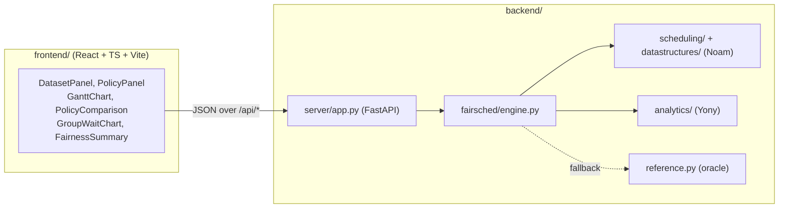

# Architecture

## Why this split

* **Python core package (`fairsched`) with no web code in it.** The course is
  about the algorithms, so they live in a plain package that can be unit tested,
  benchmarked, and run from scripts without starting a server.
* **FastAPI as a thin HTTP layer.** It validates every request against the same
  Pydantic models the core uses, gives free interactive docs at `/docs`, and is
  a few dozen lines. No database: datasets are JSON files or are generated per request.
* **React + TypeScript + Vite frontend.** Type-safe mirror of the data contract
  (`src/api/types.ts`), fast dev server with a proxy to the API, and Recharts
  for bar charts. The Gantt timeline is a small hand-written SVG component.
* **One data contract.** `backend/fairsched/schema.py` defines every input and
  output. JSON Schema files in `/schemas` are generated from it, and the
  TypeScript types mirror it. See [data-format.md](data-format.md).

## Reference engine and fallback

`fairsched/reference.py` implements the full pipeline with Python builtins
(`heapq`, `sorted`, `itertools.permutations`, O(n²) inversion counting). It is
**not** a graded deliverable. It has two jobs:

1. **Test oracle:** the tests assert the team's modules produce *identical*
   output to the reference on every sample dataset.
2. **Unblock the web app:** `fairsched/engine.py` calls the team's module first
   and falls back to the reference only if it raises `NotImplementedError`.
   Each result reports which one ran in `engine.scheduler` / `engine.analytics`
   (`"team"` or `"reference"`).

Set `FAIRSCHED_ENGINE=team` to disable the fallback (useful before the demo to
prove nothing is using the reference), or `reference` to force it.

## Module ownership

| Area                                              |                 Files                 |  Owner  |
|---------------------------------------------------|---------------------------------------|---------|
| Min-heap, hash table, slot BST                    | `fairsched/datastructures/*`          |  Noam   |
| Policies, simulation loop, brute force, rebooking | `fairsched/scheduling/*`              |  Noam   |
| Dataset generator                                 | `fairsched/analytics/generator.py`    |  Yony   |
| Rselect / Dselect, percentiles, top-k             | `fairsched/analytics/selection.py`    |  Yony   |
| Inversion counting                                | `fairsched/analytics/inversions.py`   |  Yony   |
| Per-policy and per-group metrics                  | `fairsched/analytics/metrics.py`      |  Yony   |
| Benchmarks and tests                              | `scripts/run_benchmarks.py`, `tests/` |  Yony   |
| API                                               | `server/app.py`                       | shared  |
| Web app                                           | `frontend/`                           | Stevens |

## API

| Method |            Path          |               Body → Response                |
|--------|--------------------------|----------------------------------------------|
|   GET  | `/api/health`            | → `{status, schema_version}`                 |
|   GET  | `/api/policies`          | → `PolicyInfo[]`                             |
|   GET  | `/api/datasets`          | → sample names (files in `data/samples/`)    |
|   GET  | `/api/datasets/{name}`   | → `Dataset`                                  |
|  POST  | `/api/datasets/generate` |   `GeneratorParams` → `Dataset`              |
|  POST  | `/api/simulate`          |   `SimulationRequest` → `SimulationResponse` |

Errors: `404` unknown sample, `422` invalid input (including `optimal` on more
than 8 patients), `501` a module is unimplemented while `FAIRSCHED_ENGINE=team`.

## Simulation semantics

See the docstring in `fairsched/scheduling/simulator.py`. In short: providers
sit in a min-heap keyed on next free time; whenever one frees up it takes the
waiting patient with the smallest policy key; ties always break by
`(arrival_time, id)`. A provider may not start a visit at or after its
`shift_end`; patients never started are `unserved`.
